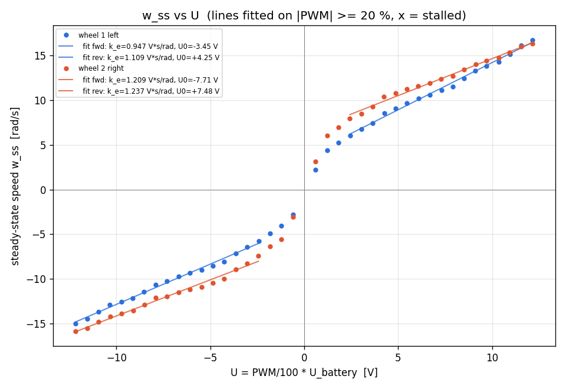
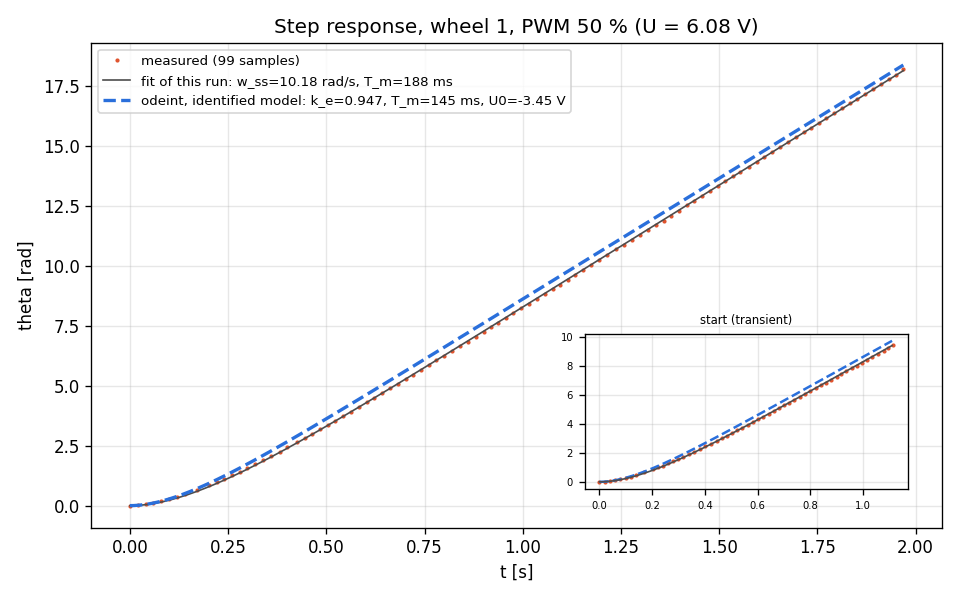
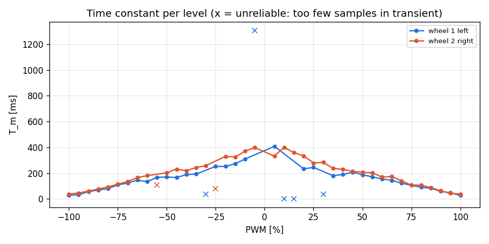
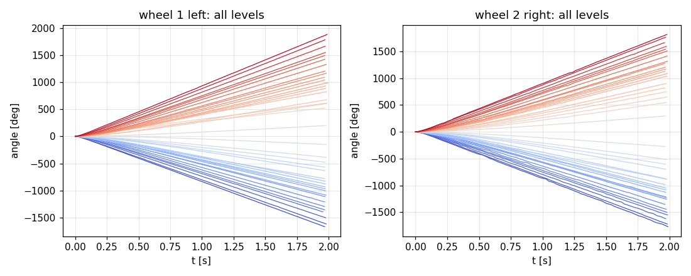

# Lab 5 - Motor parameter identification

Generated by `analyze.py` from `motor_data` (80 runs, 2 wheels).

## Identified parameters

| Wheel | U_bat [V] | k_e fwd | k_e rev | **k_e** [V*s/rad] | U0 fwd [V] | U0 rev [V] | stalled up to PWM fwd/rev | **T_m** median [ms] | T_m IQR [ms] | w_ss @100 % [rad/s] | encoder sign | median dt [ms] |
|---|---|---|---|---|---|---|---|---|---|---|---|---|
| 1 left | 12.17 | 0.947 | 1.109 | **1.028** | -3.45 | 4.25 | 0 % / 0 % | **145** | 82-188 | 16.74 | + | 20.0 |
| 2 right | 12.15 | 1.209 | 1.237 | **1.223** | -7.71 | 7.48 | 0 % / 0 % | **172** | 92-230 | 16.36 | + | 20.0 |

k_e and U0 come from a straight-line fit `w_ss = (U - U0)/k_e` on |PWM| >= 20 %, separately for forward and reverse (U0 is where that line crosses zero speed; it is not the dead zone). "Stalled" = slower than 3 % of the wheel's top speed. T_m is the median over the fitted levels, using only fits with at least 4 samples inside the transient.

## w_ss against voltage

## Step response: measurement vs identified model

Grey: two-parameter fit of this single run. Blue dashed: `odeint` simulation of `T_m*dw/dt + w = (U - U0)/k_e` with the wheel's identified k_e, U0 and median T_m.

## Per-level results

### Wheel 1 left

| PWM [%] | U [V] | w_ss [rad/s] | T_m [ms] | fit RMSE [deg] | samples | median dt [ms] | max dt [ms] | note |
|---|---|---|---|---|---|---|---|---|
| -100 | -12.17 | -15.00 | 29 | 0.8 | 97 | 20.0 | 35 |  |
| -95 | -11.55 | -14.48 | 33 | 1.3 | 99 | 20.0 | 33 |  |
| -90 | -10.95 | -13.66 | 57 | 1.2 | 100 | 20.0 | 33 |  |
| -85 | -10.35 | -12.89 | 69 | 1.7 | 94 | 20.0 | 36 |  |
| -80 | -9.74 | -12.52 | 79 | 1.6 | 97 | 20.0 | 35 |  |
| -75 | -9.14 | -12.15 | 110 | 0.9 | 99 | 20.0 | 36 |  |
| -70 | -8.53 | -11.43 | 122 | 1.3 | 98 | 20.0 | 32 |  |
| -65 | -7.91 | -10.62 | 146 | 1.4 | 95 | 20.0 | 39 |  |
| -60 | -7.31 | -10.25 | 134 | 1.4 | 98 | 20.0 | 35 |  |
| -55 | -6.70 | -9.71 | 167 | 0.7 | 98 | 20.0 | 35 |  |
| -50 | -6.08 | -9.35 | 170 | 1.2 | 99 | 20.0 | 29 |  |
| -45 | -5.47 | -9.00 | 166 | 1.4 | 96 | 20.0 | 31 |  |
| -40 | -4.87 | -8.56 | 189 | 1.5 | 98 | 20.0 | 36 |  |
| -35 | -4.26 | -8.08 | 193 | 1.6 | 98 | 20.0 | 40 |  |
| -30 | -3.65 | -7.12 | 37 | 2.3 | 98 | 20.0 | 30 | not from rest: T_m dropped, w_ss = tail slope |
| -25 | -3.04 | -6.42 | 252 | 1.8 | 99 | 20.0 | 32 |  |
| -20 | -2.43 | -5.77 | 252 | 0.7 | 98 | 20.0 | 30 |  |
| -15 | -1.83 | -4.88 | 274 | 0.8 | 97 | 20.0 | 32 |  |
| -10 | -1.22 | -4.02 | 309 | 1.3 | 98 | 20.0 | 36 |  |
| -5 | -0.61 | -2.78 | 1308 | 2.0 | 100 | 20.0 | 32 | T_m unreliable |
| 5 | 0.61 | 2.21 | 408 | 0.6 | 98 | 20.0 | 31 |  |
| 10 | 1.22 | 4.40 | 1 | 8.3 | 98 | 20.0 | 39 | not from rest: T_m dropped, w_ss = tail slope |
| 15 | 1.83 | 5.24 | 1 | 5.6 | 99 | 20.0 | 35 | not from rest: T_m dropped, w_ss = tail slope |
| 20 | 2.43 | 6.03 | 233 | 1.2 | 99 | 20.0 | 30 |  |
| 25 | 3.04 | 6.79 | 244 | 0.9 | 98 | 20.0 | 33 |  |
| 30 | 3.65 | 7.43 | 38 | 2.5 | 99 | 20.0 | 36 | not from rest: T_m dropped, w_ss = tail slope |
| 35 | 4.26 | 8.58 | 180 | 2.4 | 98 | 20.0 | 36 |  |
| 40 | 4.87 | 9.09 | 189 | 1.3 | 97 | 20.0 | 38 |  |
| 45 | 5.48 | 9.66 | 207 | 2.2 | 100 | 20.0 | 36 |  |
| 50 | 6.08 | 10.18 | 188 | 1.6 | 99 | 20.0 | 32 |  |
| 55 | 6.69 | 10.59 | 172 | 1.4 | 97 | 20.0 | 35 |  |
| 60 | 7.30 | 11.13 | 155 | 1.3 | 98 | 20.0 | 34 |  |
| 65 | 7.90 | 11.50 | 144 | 1.7 | 98 | 20.0 | 36 |  |
| 70 | 8.52 | 12.45 | 122 | 1.9 | 99 | 20.0 | 31 |  |
| 75 | 9.12 | 13.31 | 106 | 2.0 | 96 | 20.0 | 31 |  |
| 80 | 9.71 | 13.86 | 91 | 1.8 | 97 | 20.0 | 34 |  |
| 85 | 10.34 | 14.29 | 83 | 1.6 | 98 | 20.0 | 32 |  |
| 90 | 10.94 | 15.17 | 59 | 1.7 | 99 | 20.0 | 31 |  |
| 95 | 11.56 | 16.16 | 47 | 1.2 | 94 | 20.0 | 35 |  |
| 100 | 12.14 | 16.74 | 28 | 1.3 | 75 | 26.0 | 45 |  |

### Wheel 2 right

| PWM [%] | U [V] | w_ss [rad/s] | T_m [ms] | fit RMSE [deg] | samples | median dt [ms] | max dt [ms] | note |
|---|---|---|---|---|---|---|---|---|
| -100 | -12.17 | -15.85 | 38 | 4.2 | 74 | 24.0 | 61 |  |
| -95 | -11.55 | -15.50 | 47 | 1.8 | 99 | 20.0 | 33 |  |
| -90 | -10.94 | -14.78 | 61 | 3.7 | 71 | 27.5 | 48 |  |
| -85 | -10.32 | -14.19 | 77 | 3.8 | 84 | 21.0 | 39 |  |
| -80 | -9.72 | -13.89 | 94 | 2.6 | 98 | 20.0 | 38 |  |
| -75 | -9.12 | -13.54 | 114 | 4.5 | 74 | 26.0 | 54 |  |
| -70 | -8.51 | -12.88 | 134 | 2.7 | 94 | 20.0 | 33 |  |
| -65 | -7.90 | -12.11 | 166 | 2.4 | 98 | 20.0 | 36 |  |
| -60 | -7.30 | -11.95 | 181 | 2.0 | 98 | 20.0 | 36 |  |
| -55 | -6.68 | -11.50 | 107 | 5.5 | 97 | 20.0 | 36 | not from rest: T_m dropped, w_ss = tail slope |
| -50 | -6.08 | -11.14 | 202 | 2.0 | 96 | 20.0 | 39 |  |
| -45 | -5.47 | -10.88 | 232 | 2.4 | 92 | 20.0 | 38 |  |
| -40 | -4.86 | -10.43 | 219 | 2.6 | 97 | 20.0 | 37 |  |
| -35 | -4.25 | -9.98 | 244 | 2.4 | 97 | 20.0 | 38 |  |
| -30 | -3.65 | -8.90 | 258 | 2.0 | 94 | 20.0 | 34 |  |
| -25 | -3.04 | -8.26 | 80 | 4.8 | 98 | 20.0 | 31 | not from rest: T_m dropped, w_ss = tail slope |
| -20 | -2.43 | -7.39 | 330 | 1.3 | 98 | 20.0 | 30 |  |
| -15 | -1.82 | -6.38 | 325 | 1.3 | 99 | 20.0 | 36 |  |
| -10 | -1.22 | -5.57 | 371 | 1.5 | 93 | 20.0 | 37 |  |
| -5 | -0.61 | -3.04 | 398 | 1.1 | 98 | 20.0 | 32 |  |
| 5 | 0.61 | 3.13 | 333 | 0.9 | 99 | 20.0 | 29 |  |
| 10 | 1.21 | 6.04 | 400 | 1.2 | 98 | 20.0 | 32 |  |
| 15 | 1.82 | 6.97 | 359 | 1.7 | 93 | 20.0 | 53 |  |
| 20 | 2.43 | 7.95 | 333 | 1.1 | 98 | 20.0 | 31 |  |
| 25 | 3.04 | 8.47 | 279 | 3.1 | 100 | 20.0 | 25 |  |
| 30 | 3.64 | 9.30 | 284 | 1.8 | 98 | 20.0 | 34 |  |
| 35 | 4.25 | 10.39 | 237 | 3.1 | 93 | 20.0 | 36 |  |
| 40 | 4.86 | 10.82 | 230 | 2.8 | 99 | 20.0 | 37 |  |
| 45 | 5.47 | 11.22 | 214 | 3.9 | 98 | 20.0 | 38 |  |
| 50 | 6.07 | 11.56 | 207 | 2.2 | 98 | 20.0 | 35 |  |
| 55 | 6.69 | 11.91 | 202 | 3.4 | 93 | 20.0 | 37 |  |
| 60 | 7.29 | 12.40 | 170 | 2.8 | 99 | 20.0 | 34 |  |
| 65 | 7.91 | 12.69 | 173 | 2.0 | 99 | 20.0 | 35 |  |
| 70 | 8.50 | 13.40 | 140 | 2.9 | 98 | 20.0 | 31 |  |
| 75 | 9.13 | 14.02 | 107 | 3.5 | 94 | 20.0 | 43 |  |
| 80 | 9.71 | 14.44 | 107 | 2.6 | 97 | 20.0 | 36 |  |
| 85 | 10.34 | 14.73 | 87 | 2.3 | 99 | 20.0 | 41 |  |
| 90 | 10.93 | 15.32 | 64 | 2.6 | 98 | 20.0 | 31 |  |
| 95 | 11.55 | 15.99 | 43 | 2.6 | 95 | 20.0 | 32 |  |
| 100 | 12.15 | 16.36 | 39 | 2.1 | 98 | 20.0 | 36 |  |

## Discussion (draft - rewrite in your own words)

- The linear model fails at low voltage: wheel 1 moves already at 5 % forward / moves already at 5 % reverse, line offset U0 = -3.45 / +4.25 V; wheel 2 moves already at 5 % forward / moves already at 5 % reverse, line offset U0 = -7.71 / +7.48 V. Just outside the dead zone the speed rises faster than the straight line, so one k_e cannot describe the whole range.
- T_m is not constant either (wheel 1: T_m 408 ms at low |PWM| vs 28 ms at 100 %; wheel 2: T_m 400 ms at low |PWM| vs 38 ms at 100 %): friction makes the motor look slower at low voltage.
- Directions are not symmetric: wheel 1 forward/reverse k_e differ by 15.8 %, wheel 2 forward/reverse k_e differ by 2.2 %.
- 6 run(s) did not start from rest (wheel 1 at -30 %, wheel 1 at 10 %, wheel 1 at 15 %, wheel 1 at 30 %, wheel 2 at -55 %, wheel 2 at -25 %): the wheel was already turning at the first sample, so their T_m was dropped and w_ss taken from the steady part only.
- Wheels 1 and 2 differ by 17.3 % in fitted k_e. With equal PWM on both sides the robot will not go straight (track 0.190 m): at 50 % PWM 10.18 vs 11.56 rad/s, a 12.7 % mismatch -> circle of radius ~1.5 m (about 38 deg of heading per metre); at 100 % PWM 16.74 vs 16.36 rad/s, a 2.3 % mismatch -> circle of radius ~8.1 m (about 7 deg of heading per metre). The mismatch depends on speed, so one fixed correction factor is not enough.
- For odometry this means a model that assumes identical motors (or converts PWM to speed instead of reading the encoders) accumulates heading error that grows with distance, and heading error turns into position error; per-wheel k_e, U0 and T_m from this table should be used in Week 6.
